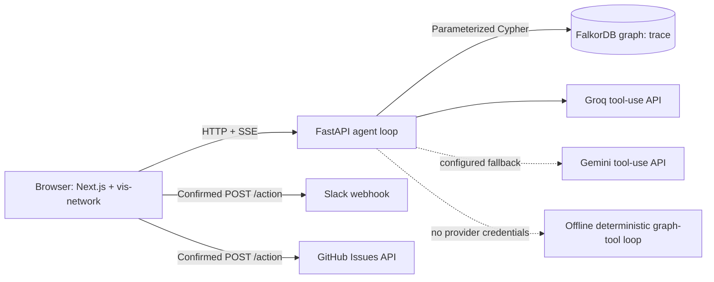

# ◈ Trace — Engineering Decision Memory Agent

A change lands. Trace walks the connected service graph, checks active incident state, surfaces ownership conflicts, identifies available experts, and prepares auditable actions before production finds out.

> **WeMakeDevs Graph Hacks · Track 01: Agents That Act on Connected Data**

## Current implementation status

- **Verified locally:** graph-backed seed tools, PR-445 impact calculation, incident/owner conflict detection, expert availability, reasoning-step persistence/replay in the memory adapter, FastAPI endpoints, SSE event framing, confirmation gate, and mocked external-action success/failure paths.
- **Implemented but not yet runtime-verified in this environment:** vis-network frontend, Next.js production build, Docker cold start, live FalkorDB adapter, Groq/Gemini API calls, Slack webhook, GitHub Issues, and hosted deployment.
- The execution environment did not have Docker installed or credentials for external services. Missing services are not silently represented as successes.

## What Trace does

1. Resolves a PR, service, person, incident, or change ID from the graph.
2. Walks transitive dependents up to four hops using the specified `dependent -> provider` direction.
3. Computes a compound path-strength ranking by multiplying dependency-edge strengths.
4. Checks which impacted services have open incidents and who is assigned.
5. Detects owners who already have incident assignments and identifies available experts.
6. Writes each tool call as a `:ReasoningStep` node linked to the session and examined graph nodes.
7. Streams findings as SSE events while the frontend lights up newly discovered nodes.
8. Offers two evidence-based follow-up actions: a Slack notification and a GitHub checklist issue. Actions require a deliberate review/confirm click and only report success after the external API accepts the request.

Path strength is a product score used for ranking. It is **not** a calibrated probability of an incident occurring.

## Architecture



The app explicitly reports whether the graph backend is `memory-seeded` or `falkordb`, and whether the agent is running in offline mode or using a provider. The offline adapter uses the same source-of-truth seed data and graph calculations; it does not claim to have called an LLM.

## Graph schema

Node labels:

- `Service(name, criticality, tier, language)`
- `Person(name, role, slack_handle, team)`
- `Incident(id, severity, status, opened_at, closed_at, root_cause)`
- `Change(id, type, title, merged_at, risk_level)`
- `Runbook(id, title, url)`
- `Session(id, created_at, query)`
- `ReasoningStep(id, hop_number, cypher_issued, finding, created_at)`

Relationship types:

- `(Service)-[:DEPENDS_ON {strength, type}]->(Service)` — dependent to provider
- `(Service)-[:OWNED_BY]->(Person)`
- `(Person)-[:EXPERT_IN {depth}]->(Service)`
- `(Change)-[:MODIFIED]->(Service)` and `(Change)-[:AUTHORED_BY]->(Person)`
- `(Incident)-[:AFFECTED]->(Service)` and `(Incident)-[:CAUSED_BY {confidence}]->(Change)`
- `(Incident)-[:RESOLVED_BY]->(Person)` and `(Person)-[:ASSIGNED_TO]->(Incident)`
- `(Runbook)-[:APPLIES_TO]->(Service)`
- `(Session)-[:STEP {order}]->(ReasoningStep)-[:EXAMINED]->(any examined graph entity)`

## Demo result and source discrepancies

Use `PR-445 just merged`. The seeded tools resolve it to `auth-service` and calculate eight dependent services. The active incidents found are `INC-004` on `notification-svc` (Yuki Tanaka) and `INC-005` on `billing-core` (Diego Reyes). Both owners are already handling active incidents. Ana Kovač is available and has expertise covering multiple affected services.

Two discrepancies in the supplied Bible have been resolved explicitly rather than hidden:

1. The seed code lists six changes while the prose says ten. This project retains all six original changes and adds four historical, schema-consistent nodes (`PR-439`, `DEPLOY-87`, `PR-438`, `PR-436`) to meet the declared target of ten.
2. The Bible describes two P0 dependents. Its own seed labels `payment-gateway`, `fraud-detector`, and `billing-core` as P0, and each directly depends on `auth-service`. The actual computed result is therefore **three P0 dependents**, not two. The implementation keeps the graph as specified and reports the computed value.

## Requirements

- Python 3.11+ (Docker uses Python 3.12)
- Node.js 22 and npm for the frontend
- Docker Compose for the FalkorDB stack (not required for memory-backed development)
- Optional API credentials for Groq or Google AI Studio
- Optional Slack incoming webhook URL and GitHub token/repository for actual side effects

The supplied frontend target was Next.js 14.2.35. As of October 2026, Next.js 14 is no longer in the upstream supported-version list. This pin is retained for compatibility with the submitted architecture, but **do not deploy this version to an internet-facing production environment before upgrading to a currently supported version and rerunning the frontend build/security review**. See the [Next.js support policy](https://nextjs.org/support-policy).

## Run without Docker (offline development)

Copy `.env.example` to `.env`. Leave `TRACE_GRAPH_BACKEND=memory` and set `TRACE_LLM_PROVIDER=offline` (or leave `auto` with no API key configured).

Backend, in one terminal:

```bash
cd backend
python -m venv .venv
# Windows PowerShell: .venv\Scripts\Activate.ps1
# macOS/Linux: source .venv/bin/activate
pip install -r requirements.txt
python seed.py
uvicorn main:app --reload --port 8000
```

Frontend, in another terminal:

```bash
cd frontend
npm install
npm run dev
```

Open <http://localhost:3000>. The default query is `PR-445 just merged`. In offline mode the findings are computed by the graph tools over the seeded memory graph, not by an external model or a live monitoring system.

## Run with FalkorDB using Docker Compose

After installing Docker Desktop (Windows/macOS) or Docker Engine + Compose (Linux):

```bash
cp .env.example .env
# PowerShell: Copy-Item .env.example .env
# Add desired provider keys and action credentials to .env; do not commit it.
docker compose up --build
```

Open <http://localhost:3000>. The Compose stack configures the backend to use FalkorDB, initializes indexes and seeds the `trace` graph idempotently at API startup. If FalkorDB is unreachable or its client cannot be installed, the backend fails visibly rather than silently switching to memory mode.

## Configure LLM providers

Provider selection is server-side through `.env`:

```dotenv
TRACE_LLM_PROVIDER=auto
GROQ_API_KEY=...
GROQ_MODEL=openai/gpt-oss-20b
GEMINI_API_KEY=...
GEMINI_MODEL=gemini-3.8-flash
```

- `auto`: Groq primary, Gemini fallback when a Groq request fails and a Gemini key is present; when neither key is configured, the agent explicitly runs its offline deterministic tool loop.
- `groq` or `gemini`: force that provider. Missing credentials or API errors become visible trace errors.
- `offline`: explicitly disable LLM provider calls.

The model IDs are configuration defaults checked against the providers' current documentation; actual access, quotas, and billing requirements depend on the provider account and have not been verified from this environment. See [Groq tool use](https://console.groq.com/docs/tool-use/overview), [Groq model/API reference](https://console.groq.com/docs/api-reference), and [Gemini model list](https://ai.google.dev/gemini-api/docs/models).

## Configure real actions

For Slack, set `SLACK_WEBHOOK_URL` to an incoming webhook you control. Slack success is reported only when the HTTP status is successful and the response body is `ok`.

For GitHub Issues, set `GITHUB_REPO=owner/repository` and a token permitted to create repository issues. The response must include an issue number and URL before success is reported. Tokens should have only the permissions needed for this task.

Missing credentials return a clear error; there is no mock integration or fake success path. Keep `.env` private. The browser bundle contains no action credentials.

## API endpoints

| Method | Path | Purpose |
|---|---|---|
| `GET` | `/health` | API, graph-backend and agent-provider status |
| `GET` | `/graph/nodes` | Seed graph nodes/edges with stable identifiers |
| `POST` | `/trace` | Stream agent events as `text/event-stream` |
| `GET` | `/replay/{session_id}` | Retrieve stored reasoning steps in hop order |
| `POST` | `/action` | Execute a confirmed Slack or GitHub action |
| `GET` | `/docs` | FastAPI-generated API documentation |

`POST /trace` event names: `start`, `step`, `provider_fallback` (when applicable), `final`, `error`, and `done`. The browser parser handles fragmented chunks, multiple events, CRLF separators, multiline data fields, and end-of-stream flush.

## Cypher templates

The actual parameterized queries are in `backend/graph_store.py`; readable, runnable templates are in `backend/schema_init.cypher`. The impact query follows reverse dependency impact by finding `(dep)-[:DEPENDS_ON*1..4]->(target)` and multiplies edge `strength` values. The owner-conflict query collects incident IDs for owners of impacted services. Values are bound as Cypher parameters.

## Tests and verification

From the project root:

```bash
PYTHONPATH=backend pytest -q backend/tests
node --test frontend/src/lib/sse-parser.test.mjs
```

`python backend/seed.py` prints seed counts and the calculated impact set. In the verified memory adapter the expected counts are 12 services, 8 people, 5 incidents, 10 changes, 3 runbooks, and 75 seed relationships. The local API tests cover the full offline trace and replay. External API tests use a mocked HTTP client and are not a substitute for testing your actual webhook/token.

## Demo script

1. Start API and frontend, open the default `PR-445 just merged` query.
2. Say: “Here's PR-445. Watch Trace walk from auth-service to the services that depend on it.”
3. Point to the `billing-core → auth-service` path, the active `INC-005` assignment to Diego, and the separate notification-service incident assigned to Yuki.
4. Note that the seed's computed impact has 3 P0 services because the written seed makes billing-core P0; the UI displays calculated graph output rather than overriding it to fit the pitch.
5. Review either action and click `CONFIRM & SEND`. With no credentials, the integration must show a missing-configuration error and must not claim delivery.

## Recording / submission checklist

- [ ] Record PR-445 input, discovered graph paths, and reasoning diamonds
- [ ] Show Diego/Yuki owner-conflict findings and Ana's availability
- [ ] Configure a real Slack webhook and capture the accepted message, if available
- [ ] Configure GitHub Issues and capture the created issue, if available
- [ ] Capture a fallback trace where an entity cannot be resolved
- [ ] Add the recorded demo URL or GIF only after it exists
- [ ] Add the actual repository URL after creating and authorizing a remote
- [ ] Disclose AI coding assistance accurately (this project was prepared with AI coding assistance)

No repository remote, cloud deployment, public URL, screenshot, GIF, or demo recording has been fabricated or created as part of this run.
