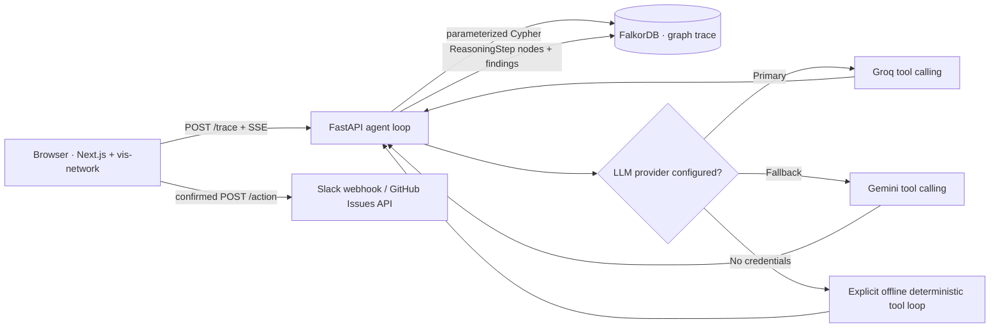

# Trace architecture

## Trust boundaries

- The browser never receives model keys, a Slack webhook, a GitHub token, or graph credentials.
- A trace can propose actions, but it cannot execute a side effect. `POST /action` requires `confirmed: true` independently of the LLM.
- Offline mode is openly identified in `/health`; its conclusions are calculated by graph tools over the seeded memory adapter, not presented as LLM output or external live state.
- A live FalkorDB adapter uses bound parameters for values. The only interpolated Cypher fragments are fixed labels/relationship names and the validated integer hop limit (1–4).
- Compound path-strength is a ranking score formed by multiplying edge strengths, not a calibrated production incident probability.
